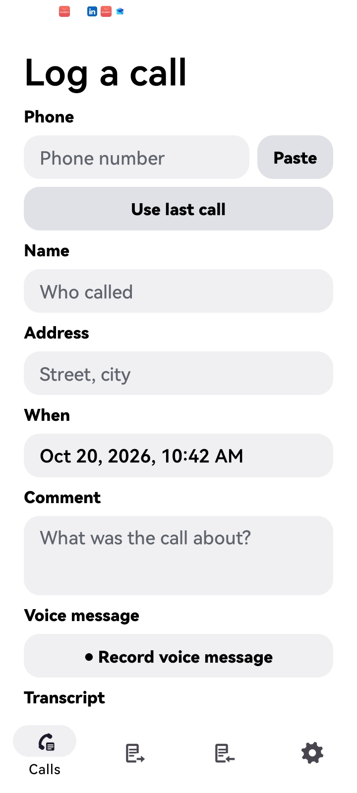
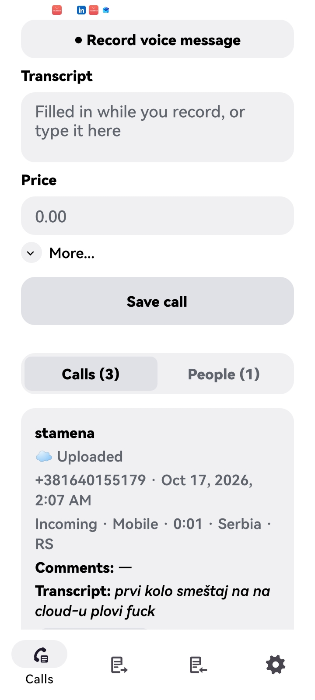
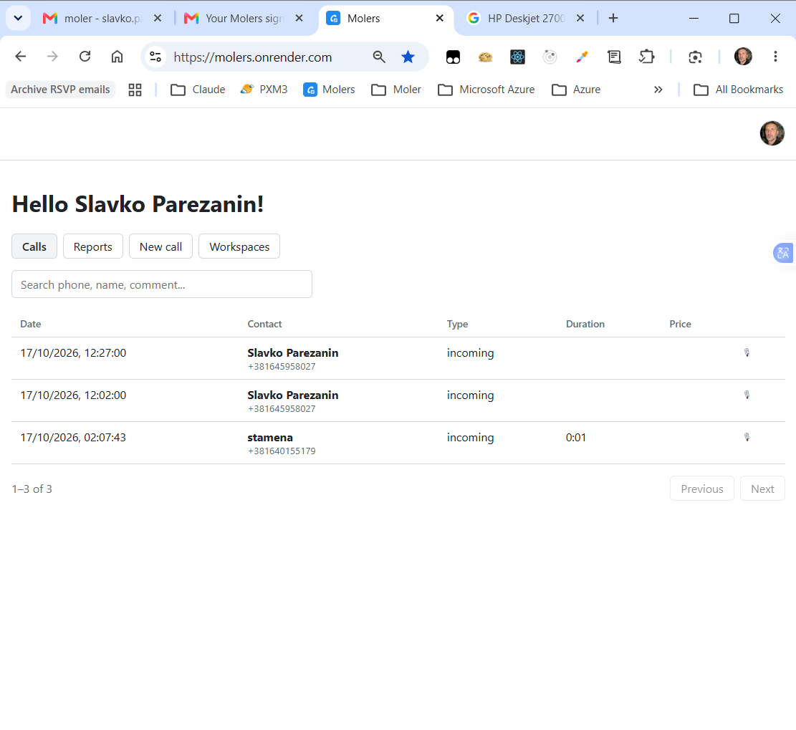
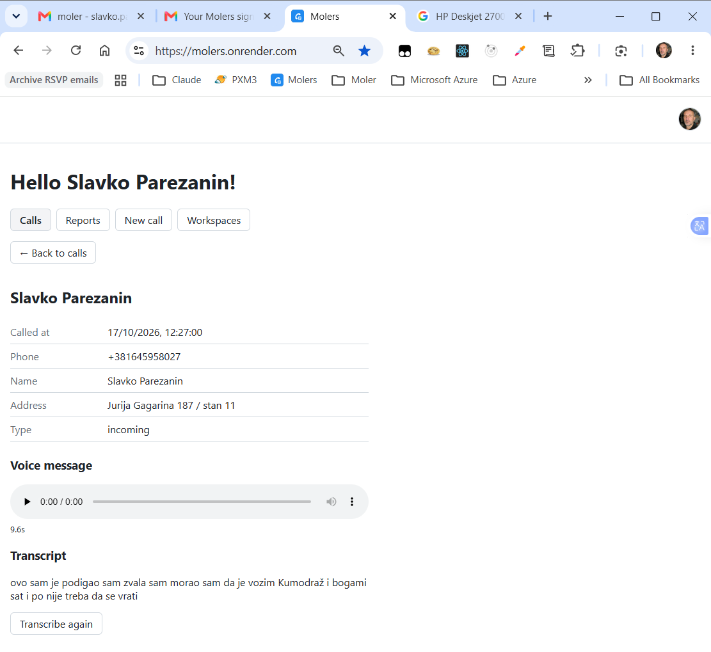

This is an [Expo](https://expo.dev) project created with [`create-expo-app`](https://www.npmjs.com/package/create-expo-app).

## Screenshots

### Mobile app

<p>
  
  
</p>

### Online workspace at [molers.onrender.com](https://molers.onrender.com)

Calls list:



A call with its voice message and transcript:



## User manual

moler is a log of business phone calls: who called, when, what it was about, the price, and a voice note that is turned into text. Calls can be exported to XML, imported from colleagues' files, and (in online mode) sent to a shared workspace.

The app has four tabs: **Calls**, **Exports**, **Imports** and **Settings**.

### 1. Logging a call (Calls tab)

1. **Phone**: type the number, tap **Paste** to paste a copied number, or tap **Use last call** (Android) to fill in the number, time, duration and other details of the most recent call from the phone's call log. The first time, Android asks for permission to read the call log.
2. **Name** and **Address**: for a number you have saved before, these fill in by themselves.
3. **When**: the time of the call; tap it to change the date and time.
4. **Comment**: what the call was about.
5. **Voice message**: tap **● Record voice message**, speak, then tap **■ Stop**. The speech is turned into text in **Transcript** (Serbian). Tap **▶ Play** to listen, or **Delete** to record again. **🎤 Dictate** fills in the transcript without keeping a recording; it appears only on phones with a speech service.
6. **Transcript**: you can correct the text by hand.
7. **Price**: an amount like `12.50` or `12,50`.
8. **More…**: call type, duration, location, number type, country and video call. **Use last call** fills these in.
9. Tap **Save call**.

Below the form:

- **Calls**: all calls, newest first, with their comments and transcripts. Tap **▶ Voice** to play a voice message. **Long-press** a call to delete it.
- **People**: calls grouped by person, with the number of calls, total price and talk time. Tap a person to see their calls or log a new call from them.
- A call that went into an export shows **✓ Exported**. In online mode each call shows **☁ Uploaded**, or **⚠ Not uploaded** with a **Retry** button.

**Speech-to-text.** Phones with a speech service (most phones with Google services) show the text live while you speak. Phones without one, such as Huawei phones without Google services, send the recording to the moler server after you tap **Stop**, and the text arrives a few seconds later. An internet connection is needed for that.

**Opening the app from another app.** The link `moler://calls?caller=+381601234567` opens moler with the number already filled in. Automation apps such as MacroDroid can open it when a call ends.

### 2. Exporting calls (Exports tab)

1. Enter **Your name or e-mail** once. It becomes part of the file name and is saved in the file. If it's empty, the phone's name is used.
2. Tap **Export N new calls to XML**. Every call not exported before goes into one XML file, and those calls are marked as exported, so the next export contains only new calls.
3. The share menu opens: send the file by e-mail or Viber, or save it to Google Drive. A copy always stays on the phone in **Download/moler**.

Files are named `moler-calls-{name}-{date}-{time}.xml`, for example `moler-calls-ana-at-example.com-2026-10-12-14-35.xml`.

Tap an earlier export to see its calls and the XML, and to share it again. Voice messages are not included in the XML, only their length.

### 3. Importing calls (Imports tab)

Imports collect calls from other people's export files, for example a manager collecting the calls of a team. Imported calls are kept separate from your own calls.

1. Optionally choose **From** and **To** days. Only calls from those days are imported and shown; leave them empty for all calls.
2. Choose where the files are:
   - **Choose folder and import**: pick a folder on the phone, for example **Download/moler**. **Import again from …** reads the same folder later without asking.
   - **Google Drive folder**: share the Drive folder once with the e-mail shown in the app (**Viewer** is enough), paste the folder link (Drive → Share → Copy link), and tap **Import from Google Drive**.
3. Every file whose name starts with `moler-calls` is read. A call that is already in the list is skipped, so you can import the same folder as often as you like.

The list is grouped by day, then by the person who made the export, oldest call first, with the number of calls and the total price.

### 4. Settings: offline or online

- **Offline** (default): calls are stored only on this phone. Best for a single user.
- **Online**: each saved call, with its voice message, is also sent to a shared workspace at [molers.onrender.com](https://molers.onrender.com). Best for several users. Register the workspace on the website, then enter its name in **Workspace**. Calls stay on the phone too. Calls saved before you switched to online are not sent.

### 5. Where your data is stored

- Calls, people, voice messages, exports and imports are stored in a local database on the phone (`moler.db` in the app's private storage).
- Exported XML files are also saved in **Download/moler**.
- In online mode, calls are also stored in your workspace on molers.onrender.com.
- Uninstalling the app, or **Settings → Apps → moler → Storage → Clear data**, deletes everything on the phone. Export your calls first if you need to keep them.
- Privacy policy: <https://moler.expo.app/privacy>

### 6. Recording phone calls

**moler cannot record the phone call itself.** Since Android 9 and 10, Android doesn't let ordinary apps record call audio, and Google Play no longer allows apps to work around that. The voice message in moler is your own note, recorded before or after the call.

Many phones can record calls in their **built-in Phone app**, depending on the manufacturer, the country and the software version:

| Phone | Where to find it (if your model and country support it) |
|---|---|
| Phones with the **Google Phone** app (Google Pixel, Motorola, Nokia and others) | During a call: **Record**. Phone app → Settings → **Call recording** for automatic recording. Only in supported countries; both sides hear a message that the call is being recorded. |
| **Samsung** (One UI) | During a call: **⋮ → Record call**. Phone app → **⋮ → Settings → Record calls** for automatic recording. |
| **Xiaomi / Redmi / POCO** (MIUI, HyperOS) | During a call: **Record**, on models that use Xiaomi's own Phone app. Newer models with the Google Phone app work as in the first row. |
| **OnePlus, OPPO, realme** (ColorOS, OxygenOS) | During a call: **Record**. Phone app → Settings → **Call recording** for automatic recording. |
| **vivo** | During a call: **Record**, or Phone app settings → **Call recording**. |
| **Huawei / Honor** | During a call: **⋮ → Record**, on models and regions where the Phone app offers it. |
| **iPhone** | iOS 18.1 and newer: the **record button** during a call, in supported countries; both sides hear an announcement. The recording and its transcript are saved in the Notes app. |

To check your phone, make a test call: if the call screen has a **Record** button (sometimes under **⋮**), your phone supports it. If not, your manufacturer has turned the feature off for your country or model.

moler can't attach those recordings to a call yet. After the call, record a short voice message in moler with the important points; it is turned into text automatically.

**Please note:** recording a conversation can be illegal without the other person's consent, depending on the country. Tell the other person that the call is being recorded, and check the rules where you live.

## Get started

1. Install dependencies

   ```bash
   npm install
   ```

2. Start the app

   ```bash
   npx expo start
   ```

In the output, you'll find options to open the app in a

- [development build](https://docs.expo.dev/develop/development-builds/introduction/)
- [Android emulator](https://docs.expo.dev/workflow/android-studio-emulator/)
- [iOS simulator](https://docs.expo.dev/workflow/ios-simulator/)
- [Expo Go](https://expo.dev/go), a limited sandbox for trying out app development with Expo

You can start developing by editing the files inside the **app** directory. This project uses [file-based routing](https://docs.expo.dev/router/introduction).

## Get a fresh project

When you're ready, run:

```bash
npm run reset-project
```

This command will move the starter code to the **app-example** directory and create a blank **app** directory where you can start developing.

### Other setup steps

- To set up ESLint for linting, run `npx expo lint`, or follow our guide on ["Using ESLint and Prettier"](https://docs.expo.dev/guides/using-eslint/)
- If you'd like to set up unit testing, follow our guide on ["Unit Testing with Jest"](https://docs.expo.dev/develop/unit-testing/)
- Learn more about the TypeScript setup in this template in our guide on ["Using TypeScript"](https://docs.expo.dev/guides/typescript/)

## Learn more

To learn more about developing your project with Expo, look at the following resources:

- [Expo documentation](https://docs.expo.dev/): Learn fundamentals, or go into advanced topics with our [guides](https://docs.expo.dev/guides).
- [Learn Expo tutorial](https://docs.expo.dev/tutorial/introduction/): Follow a step-by-step tutorial where you'll create a project that runs on Android, iOS, and the web.

## Join the community

Join our community of developers creating universal apps.

- [Expo on GitHub](https://github.com/expo/expo): View our open source platform and contribute.
- [Discord community](https://chat.expo.dev): Chat with Expo users and ask questions.
